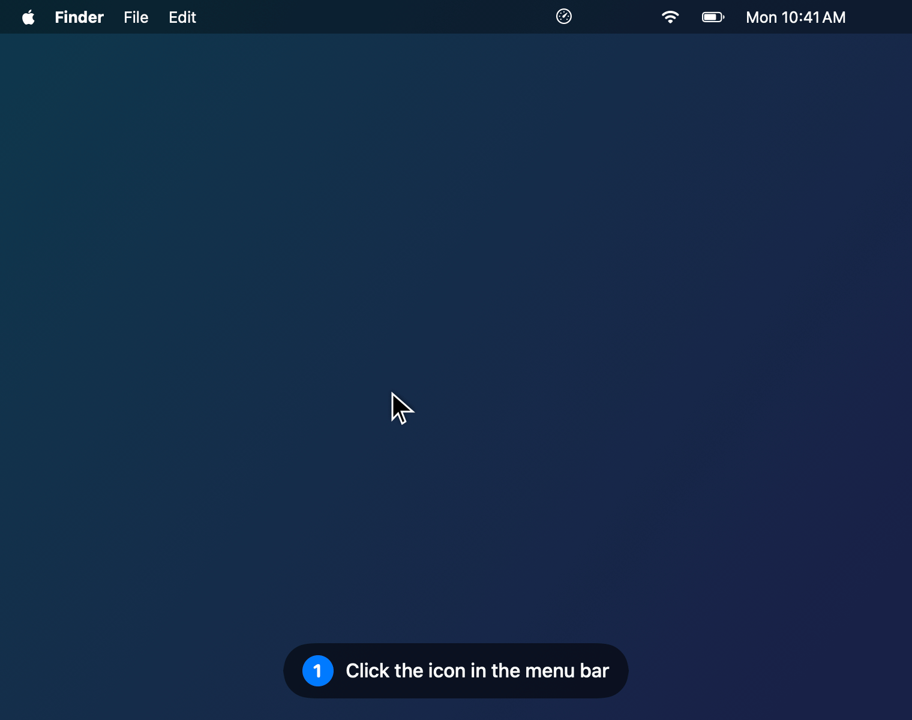

# Copilot Credits

A small macOS menu bar app that shows your **GitHub Copilot AI credits** usage — including for a seat provided by your company (Copilot Business / Enterprise), where the official billing API doesn't answer.

<p align="center"></p>

Menu bar: `⏲ 61%` · on click: credits used / allocation, reset date, average pace, daily budget to stay within quota, end-of-cycle projection, cycle chart. Notifications at 80% and 100%.

The interface is available in English and French: it follows the system language by default and can be changed from the ⋯ menu → *Language*.

> Personal project, **not affiliated with GitHub**. The app relies on an undocumented internal Copilot endpoint, which may change or disappear without notice.

## Installation

1. Download **[CopilotCredits.dmg](../../releases/latest/download/CopilotCredits.dmg)** (latest release), open it and drag the app into **Applications**.
2. The app is not notarized by Apple, so macOS blocks it on first launch. Either:
   - *System Settings → Privacy & Security* → **Open Anyway**;
   - or in Terminal:
     ```bash
     xattr -dr com.apple.quarantine "/Applications/Copilot Credits.app"
     ```
3. Launch the app, click the icon in the menu bar → **Sign in to GitHub**, then enter the code shown on github.com/login/device with the account that holds your Copilot seat.

Requirements: macOS 13 Ventura or later, Apple Silicon or Intel.

## Privacy

- The app only talks to `github.com` and `api.github.com`. No third-party server, no telemetry.
- The GitHub token is stored **only in your macOS Keychain**. Network requests use a session with no disk cache.
- The usage history stays local: `~/Library/Application Support/CopilotCredits/history.sqlite`.
- *Sign out* deletes the token from the Keychain. To revoke access on GitHub's side: *Settings → Applications → Authorized OAuth Apps → GitHub Copilot Plugin*.

## FAQ

**Authorization fails with "access_denied".** Your organization may restrict OAuth authorizations. If the [Copilot CLI](https://github.com/github/copilot-cli) is installed and signed in, use the *"Or reuse the Copilot CLI token"* link.

**macOS asks for Keychain access again after an update.** Expected: the app is ad hoc signed, so each version has a different signature. Click *Always Allow*.

**Why "premium_interactions" in the code?** It's the legacy name (from the premium requests era) under which the API still exposes AI credits.

---

## Development

Requirements: Xcode 15+ or the Command Line Tools.

```bash
./build.sh            # build/Copilot Credits.app
./build.sh install    # + copies to /Applications and launches
./build.sh dmg        # + build/CopilotCredits.dmg
UNIVERSAL=1 VERSION=0.2.0 ./build.sh dmg   # same as CI
```

### Tests

```bash
./test.sh                      # all tests (also works with the Command Line Tools only)
./test.sh --filter UsageParser # a single suite
```

The tests (Swift Testing) cover the `CopilotCreditsCore` module: API parsing, computations (pace, projection, budget), alert rules, device flow responses, Copilot CLI account selection, SQLite history.

They were written **from the specification alone** ([`Tests/SPEC.md`](Tests/SPEC.md)) by someone who hadn't seen the implementation, to avoid tests that simply mirror the code. To change a behavior: update `SPEC.md` first, then the test, then the code.

CI runs `swift test` before every build; no `.dmg` if a test fails.

### App icon

```bash
swift scripts/make-icon.swift   # regenerates Resources/AppIcon.icns
```

### Tutorial GIF

```bash
./scripts/make-tutorial.sh      # docs/tutorial.gif (+ build/tutorial/tutorial.mp4)
./scripts/make-tutorial.sh fr   # French UI: docs/tutorial-fr.gif
```

The frames are rendered from the app's real SwiftUI views with fake data (debug builds only), then assembled with `ffmpeg` (`brew install ffmpeg`). No real account or usage ever appears.

### Architecture

```
Sources/CopilotCreditsCore/  pure logic, tested
├── Models.swift             UsageSnapshot (+ pace, projection, budget)
├── UsageParser.swift        copilot_internal/user JSON → UsageSnapshot
├── DeviceFlowModels.swift   device flow types and response interpretation
├── AlertPolicy.swift        which threshold to notify
├── CopilotCLIAccount.swift  which Keychain account holds the Copilot CLI token
└── HistoryStore.swift       SQLite history of snapshots

Sources/CopilotCredits/      the app: networking, Keychain, UI
├── CopilotCreditsApp.swift  entry point, MenuBarExtra + menu bar label
├── UsageStore.swift         central state: auth, fetch every 10 min, alerts
├── CopilotAPI.swift         HTTP call to copilot_internal/user
├── DeviceFlow.swift         device flow HTTP calls
├── Keychain.swift           token storage in the Keychain
├── Localization.swift       chosen language (system / FR / EN) and tr(fr, en)
├── Notifier.swift           macOS notifications
├── Tutorial.swift           README GIF renderer (debug builds only)
└── Views.swift              SwiftUI panel + Swift Charts graph
```

**Authentication.** GitHub only reveals an account's usage to that account: each user gets their own token through the *device flow* (`POST /login/device/code`, approval on github.com, then polling `POST /login/oauth/access_token`). The client ID is the one of the official Copilot plugins' OAuth app: `copilot_internal` rejects tokens issued for any other OAuth app.

**Fetching.** `GET https://api.github.com/copilot_internal/user`, `quota_snapshots.premium_interactions` block. Used = `entitlement − quota_remaining` (+ `overage_count`); `quota_remaining` keeps decimals, `credits_used` is rounded. Fetched every 10 min, when the Mac wakes up and on demand.

**History and projection.** The API only returns a point-in-time snapshot: each one is recorded in SQLite. Linear projection (used ÷ elapsed days × cycle length); "to stay within quota" = remaining ÷ days left.

### Releasing

CI (`.github/workflows/build.yml`) builds a universal binary on a macOS runner on every push. To release:

```bash
git tag v0.2.0 && git push origin v0.2.0
```

The tag sets the app version and creates the Release with `CopilotCredits.dmg`.

## License

MIT
